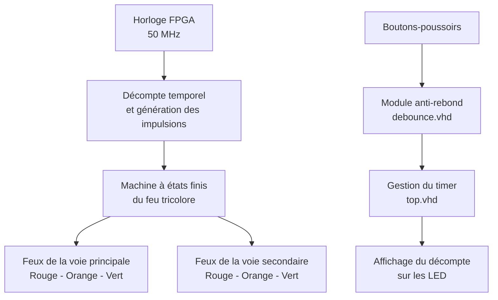

# 🚦Gestion de feux tricolores par un décompteur temporel

## 📋 1. Présentation du projet

Ce projet consiste à concevoir en **VHDL un système numérique de gestion de feux tricolores**, basé sur une logique séquentielle et des temporisations.

L’objectif est de contrôler les signaux lumineux de deux voies de circulation en respectant un ordre de passage et des durées définies. Un décompteur temporel permet de gérer le temps associé aux différentes étapes du cycle.

Le projet comprend également un module de décompte commandé par des boutons-poussoirs, ainsi qu’un module de gestion des feux tricolores.

## 2. Objectifs

- Concevoir des circuits numériques en VHDL.
- Utiliser une machine à états finis (FSM) pour organiser les séquences de fonctionnement.
- Générer des temporisations à partir d’une horloge de 50 MHz.
- Gérer les changements de couleurs des feux tricolores.
- Prendre en compte les rebonds des boutons-poussoirs grâce à un module anti-rebond.
- Tester et observer le comportement des sorties sur une carte FPGA.

## 3. Architecture logicielle

Le projet est organisé en plusieurs modules VHDL. Chaque module possède un rôle précis.



**À noter :** ce schéma présente les fonctions des modules du projet. Dans les fichiers fournis, `top.vhd` et `traffic_light.vhd` constituent deux conceptions distinctes. Le schéma ne signifie donc pas que le timer et le contrôleur des feux sont déjà reliés dans une seule conception.

## 4. Rôle des fichiers VHDL

| Fichier | Fonction |
|---|---|
| `traffic_light.vhd` | Gère les états des feux tricolores et les durées des différentes phases. |
| `top.vhd` | Implémente un décompteur temporel commandé par des boutons-poussoirs. |
| `debounce.vhd` | Filtre les rebonds électriques des boutons pour fiabiliser les commandes. |

### Fonctionnement du contrôleur de feux

Le contrôleur utilise une machine à états finis pour organiser les transitions entre les différentes phases.

| État | Fonction | Durée prévue |
|---|---|---:|
| `RED` | Les deux voies sont au rouge | 1 s |
| `RED_ORANGE` | Préparation au passage au vert | 1 s |
| `GREEN` | Une voie passe au vert, l’autre reste au rouge | 10 s ou 5 s selon la voie |
| `ORANGE` | La voie autorisée repasse à l’orange avant le rouge | 2 s |

Le cycle alterne entre la voie principale et la voie secondaire afin de gérer leur passage successif.

### Fonctionnement du décompteur

Le module `top.vhd` utilise une machine à états pour gérer les étapes suivantes :

1. Attendre une commande.
2. Initialiser le décompte.
3. Saisir la valeur à l’aide des boutons.
4. Décrémenter la valeur au fil du temps.
5. Signaler la fin du décompte par le clignotement des LED.

Le module `debounce.vhd` contribue à fiabiliser les commandes en filtrant les rebonds des boutons-poussoirs.

## 5. Technologies utilisées

- **VHDL** : description du fonctionnement des circuits numériques.
- **Intel Quartus Prime Lite** : environnement de conception FPGA.
- **FPGA** : plateforme matérielle de mise en œuvre.
- **Horloge à 50 MHz** : référence temporelle utilisée pour les décomptes.
- **Machines à états finis** : gestion des séquences et des transitions.

## 6. Organisation du dépôt

```text
gestion-feux-tricolores/
├── README.md
├── src/
│   ├── top.vhd
│   ├── debounce.vhd
│   └── traffic_light.vhd
├── images/
│   └── resultats.png
└── quartus/
    └── fichiers_du_projet
```

Le dossier `images/` peut contenir les captures d’écran des simulations ou les photos des résultats obtenus sur la carte FPGA.

## 7. Résultats et compétences développées

Ce projet permet de mettre en pratique :

- la conception de circuits numériques en VHDL ;
- la gestion des temporisations et des compteurs ;
- la conception de machines à états finis ;
- la synchronisation et le filtrage des entrées ;
- l’organisation d’un projet de conception FPGA.

## 8. Conclusion

Ce projet illustre la manière dont la logique numérique et les temporisations peuvent être utilisées pour gérer un système de feux tricolores. Il constitue une application pratique du VHDL, de la conception séquentielle et de la programmation de FPGA.
